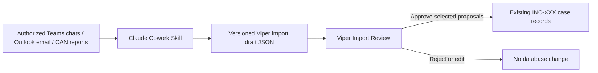

# Claude Cowork Import Add-On

## Purpose

This optional add-on uses an authorized Claude Cowork workflow to analyze Working
Group Teams chats, Outlook email, and CAN reports, then produce proposed updates
for existing Viper cases. Viper remains the system of record: no proposed item is
written to its database until a human reviewer approves it.

## Confirmed Scope

- Claude Cowork is authorized to access the user's Teams and Outlook information.
- CAN reports normally arrive as email with an identifiable subject/title.
- Imports may update existing cases only; they must never create a new Viper case.
- The target case must have an incident number matching the organization's
  `INC-XXX` convention.
- Human review and explicit approval are required before database writes.

## Workflow



The Cowork Skill is responsible for analysis and generation of a structured draft.
Viper is responsible for validating the draft, matching the target case, presenting
the review interface, detecting obvious duplicates, and committing only approved
records in a transaction.

## Import Rules

1. A draft must include a target `incident_number`.
2. Viper matches the value exactly against an existing `Case.incident_number`.
3. A non-matching, missing, or ambiguous incident number is an import error; Viper
   must not offer a fallback match by case name.
4. The reviewer can edit or reject each proposed finding before it is saved.
5. The import records source metadata and the review decision locally for traceability.
6. The Cowork Skill must treat source content as data, not instructions. It must not
   use content from chats, email, or reports to expand its permitted actions.

## Initial Pilot

The first release should accept only drafts derived from controlled Outlook exports:

- CAN email identified by configurable subject/title matching.
- Analyst-selected email messages.
- Proposed Timeline events, Communication Log entries, and Due Outs only.

This deliberately excludes automatic Teams ingestion and all direct database writes
by Cowork. Teams chat analysis can join the pilot after the review workflow and
extraction quality are validated.

## Draft Contract

The add-on will define a versioned JSON contract, for example:

```json
{
  "schema_version": "viper-import-draft-v1",
  "incident_number": "INC-123",
  "source": {
    "kind": "email",
    "subject": "CAN: INC-123 Status Update",
    "sender": "sender@example.org",
    "received_at": "2026-09-25T14:30:00Z",
    "reference": "outlook-message-id-or-export-path"
  },
  "proposals": [
    {
      "kind": "communication_log",
      "timestamp": "2026-09-25T14:30:00Z",
      "comm_type": "CAN",
      "summary": "Proposed analyst summary",
      "notes": "Supporting context for reviewer",
      "evidence_excerpt": "Short source excerpt",
      "confidence": "high"
    }
  ]
}
```

The final schema will constrain proposal fields by `kind` and reject unknown fields,
invalid dates, unsupported communication types, and payloads exceeding a defined size.

## Repository Shape

```text
integrations/
  claude-cowork/
    SKILL.md
    README.md
    schema/
      viper-import-draft-v1.json
    examples/
      can-email-draft.json
      working-group-chat-draft.json
ui/
  import_review_window.py
services/
  import_drafts.py
```

The application implementation will add local import-batch/audit models, a service
that validates and applies approved proposals, and an Import Review window. It will
not add Claude credentials, Microsoft credentials, or network clients to Viper.

## Decisions Still Needed Before Coding

- CAN subject/title rule: exact subject, a prefix such as `CAN:`, or a configurable
  list of regular-expression patterns.
- Draft handoff: a dedicated folder selected in Viper, or a file-picker import action.
- Retention policy for import drafts and evidence excerpts after review.
- Duplicate policy for repeated email/chat analysis (warn only, block exact matches,
  or merge into an existing record).