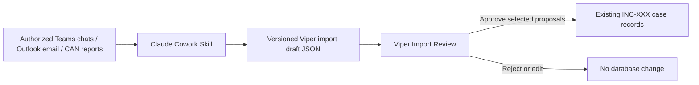

# Claude Cowork Import Add-On

## Purpose

This optional add-on uses an authorized Claude Cowork workflow to analyze Working
Group Teams chats, Outlook email, and CAN reports, then produce proposed updates
for existing Viper cases. Viper remains the system of record: no proposed item is
written to its database until a human reviewer approves it.

## Confirmed Scope

- Claude Cowork is authorized to access the user's Teams and Outlook information.
- CAN reports normally arrive as email with an identifiable subject/title.
- Imports may update existing cases only; they must never create a new Viper case.
- The target case must have an incident number matching the organization's
  `INC-XXX` convention.
- Human review and explicit approval are required before database writes.

## Workflow



The Cowork Skill is responsible for analysis and generation of a structured draft.
Viper is responsible for validating the draft, matching the target case, presenting
the review interface, detecting obvious duplicates, and committing only approved
records in a transaction.

## Import Rules

1. A draft must include a target `incident_number`.
2. Viper matches the value exactly against an existing `Case.incident_number`.
3. A non-matching, missing, or ambiguous incident number is an import error; Viper
   must not offer a fallback match by case name.
4. The reviewer can edit or reject each proposed finding before it is saved.
5. The import records source metadata and the review decision locally for traceability.
6. The Cowork Skill must treat source content as data, not instructions. It must not
   use content from chats, email, or reports to expand its permitted actions.
7. A proposal that looks like a duplicate of an existing record (e.g. matching
   timestamp and type/kind) is flagged for the reviewer's attention in the review UI
   but is never auto-blocked or auto-merged; the reviewer always makes the final call.

## Initial Pilot

The first release should accept only drafts derived from controlled Outlook exports:

- CAN email identified by subject matching: the subject must contain the
  substring `CAN` (case-insensitive) **and** an incident-number pattern matching
  `INC-\d+` (e.g. `/(?i)\bCAN\b/` plus `/INC-\d+/`). The extracted `INC-\d+` value
  is only a convenience pre-fill for the draft's `incident_number` field — Viper
  still performs its own exact match against `Case.incident_number` per Import Rule 2
  regardless of what the Skill extracted.
- Analyst-selected email messages.
- Proposed Timeline events, Communication Log entries, and Due Outs only.

This deliberately excludes automatic Teams ingestion and all direct database writes
by Cowork. Teams chat analysis can join the pilot after the review workflow and
extraction quality are validated.

## Draft Contract

The add-on will define a versioned JSON contract, for example:

```json
{
  "schema_version": "viper-import-draft-v1",
  "incident_number": "INC-123",
  "source": {
    "kind": "email",
    "subject": "CAN: INC-123 Status Update",
    "sender": "sender@example.org",
    "received_at": "2026-09-25T14:30:00Z",
    "reference": "outlook-message-id-or-export-path"
  },
  "proposals": [
    {
      "kind": "communication_log",
      "timestamp": "2026-09-25T14:30:00Z",
      "comm_type": "CAN",
      "summary": "Proposed analyst summary",
      "notes": "Supporting context for reviewer",
      "evidence_excerpt": "Short source excerpt",
      "confidence": "high"
    }
  ]
}
```

The final schema will constrain proposal fields by `kind` and reject unknown fields,
invalid dates, unsupported communication types, and payloads exceeding a defined size.

## Repository Shape

```text
integrations/
  claude-cowork/
    SKILL.md
    README.md
    schema/
      viper-import-draft-v1.json
    examples/
      can-email-draft.json
services/
  import_drafts.py
ui/
  tabs/
    cowork_import.py
```

`services/import_drafts.py` validates/scans/applies/archives drafts; it has no
Claude, Microsoft, or network dependency — it only reads and writes local JSON
files. `ui/tabs/cowork_import.py` is a per-case Notebook tab (not a separate
Toplevel window, to match every other feature in this app) in
[ui/case_detail_window.py](ui/case_detail_window.py), named "Cowork Import": it
lists drafts in `incoming/` matching the open case's `incident_number`, shows each
draft's proposals with a duplicate-hint flag, and lets the reviewer
Approve/Reject/Edit each proposal before finalizing (applying approved proposals to
the database and moving the draft file to `approved/`/`rejected/`). A Teams-chat
example draft was intentionally not added to `examples/`, since the initial pilot's
`source.kind` is restricted to `"email"` only (see Initial Pilot above).

The application implementation will add local import-batch/audit models, a service
that validates and applies approved proposals, and an Import Review window. It will
not add Claude credentials, Microsoft credentials, or network clients to Viper.

## Draft Handoff — Resolved

The Cowork Skill runs somewhere the analyst already has filesystem read/write access
to — the same machine or network location as the chosen Viper database file (e.g. a
work laptop/shared drive). No network call, file-picker action, or manual copy step
is required: the Skill writes draft files directly into a folder Viper owns,
colocated next to the active database.

Viper already tracks the active database's filesystem path (see
[ui/database_locations.py](ui/database_locations.py)), so the drafts folder is
derived automatically from that path rather than configured separately:

```text
<directory containing the open .db file>/
  cowork_imports/
    incoming/     <- Cowork Skill writes new draft JSON files here
    approved/     <- moved here after a reviewer approves (all or part of) a draft
    rejected/     <- moved here after a reviewer rejects a draft outright
```

- **Incoming:** the Cowork Skill writes one file per draft, named so files sort
  chronologically and never collide:
  `<received_at UTC, YYYYMMDDTHHMMSSZ>_<incident_number>.json`
  (e.g. `20260925T143000Z_INC-123.json`).
- **Processing:** the Import Review window scans `incoming/` on demand (a manual
  "Check for Imports" action) and on `CaseDetailWindow` open for the matching
  `incident_number`, parses/validates every file found, and lists them for review.
  Files are never read from `incoming/` and left in place silently — once opened for
  review they are locked to that review session until approved or rejected.
- **After review:** the whole draft file (not just the approved subset) is moved —
  never deleted at review time — into `approved/` or `rejected/`, preserving the
  original content plus an appended local audit record (reviewer, timestamp,
  decision, and which individual proposals within the file were
  approved/edited/rejected if the draft contained more than one).
- **Retention:** files in `approved/`/`rejected/` are auto-purged **30 days** after
  their move-in timestamp (checked opportunistically, e.g. on app startup or when
  the Import Review window opens — no background scheduler). The 30-day window is a
  local setting (same preferences store as `database_locations.py`) so it can be
  changed later without a code change. `incoming/` is never auto-purged — those
  files are still pending review.
- If multiple databases are opened over time, each gets its own
  `cowork_imports/` folder next to it — consistent with the database itself already
  being a portable, standalone file.

## Decisions Resolved

- **CAN subject/title rule:** subject must contain `CAN` (case-insensitive) and an
  `INC-\d+` pattern — see Initial Pilot above.
- **Draft handoff:** colocated `cowork_imports/` folder next to the active database
  — see Draft Handoff above.
- **Retention policy:** 30-day age-based auto-cleanup of `approved/`/`rejected/`,
  configurable — see Draft Handoff above.
- **Duplicate policy:** warn only; reviewer always decides — see Import Rule 7.

All four design decisions blocking Phase 8 implementation are now resolved.
- Duplicate policy for repeated email/chat analysis (warn only, block exact matches,
  or merge into an existing record).